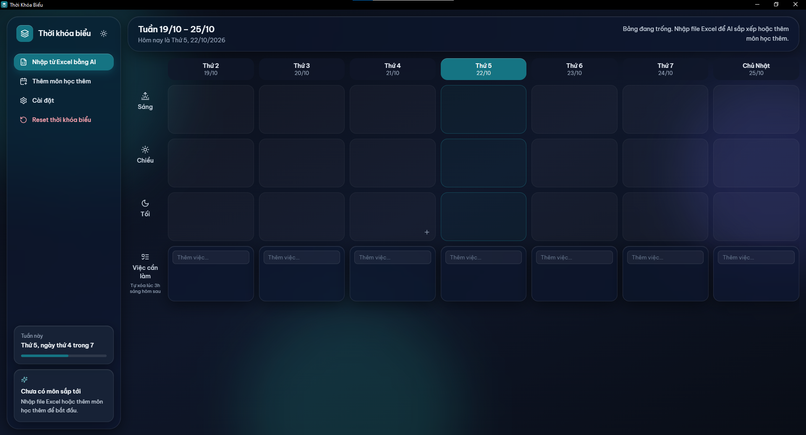
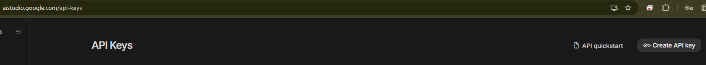
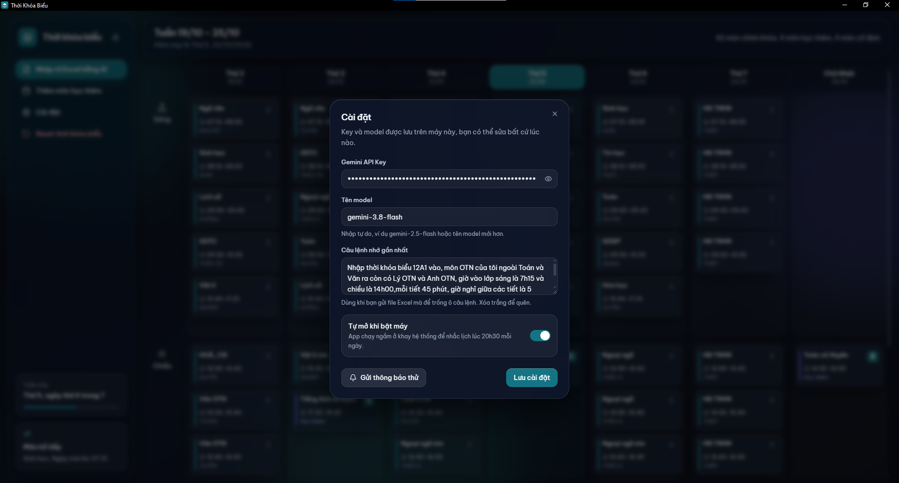
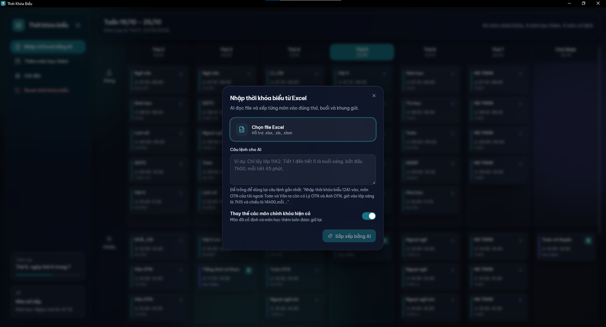
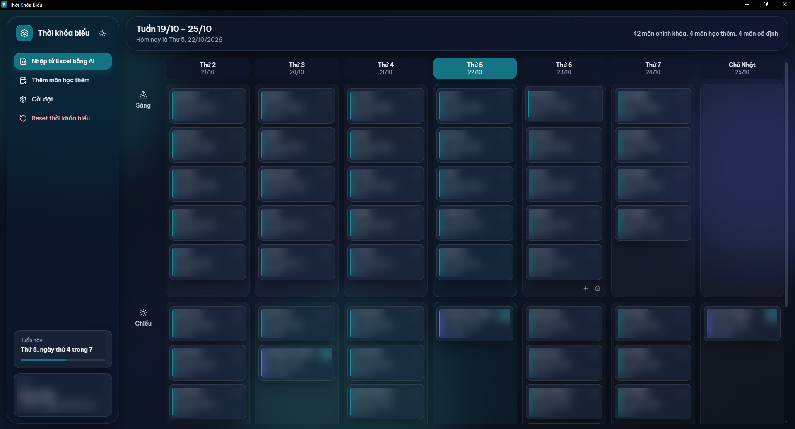
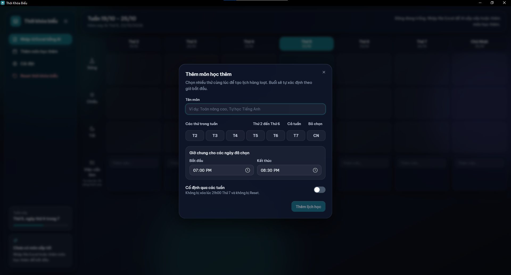

# Hướng dẫn sử dụng Thời Khóa Biểu

Hướng dẫn này dành cho Windows, từ tạo Gemini API key đến nhập thời khóa biểu Excel vào ứng dụng. Các mức miễn phí, model khả dụng và hạn mức API có thể thay đổi theo thời gian, tài khoản và khu vực. Hãy xem thông tin đang hiển thị trong Google AI Studio trước khi dùng.

## 1. Tải và mở ứng dụng

1. Tải [timetable-app.exe](https://github.com/dohuahau-stack/timetableapp/raw/refs/heads/main/timetable-app.exe) từ repository chính thức.
2. Chỉ chạy file tải từ trang GitHub của dự án. Nếu Windows hiện SmartScreen, đừng tắt bảo vệ chỉ để tiếp tục; hãy xác minh nguồn phát hành với người duy trì dự án.
3. Mở ứng dụng. Bạn không cần cài Node.js hay Rust để dùng file `.exe`.

## 2. Tạo API key trong Google AI Studio

1. Mở [Google AI Studio – API keys](https://aistudio.google.com/app/apikey) và đăng nhập Google.
2. Chọn **Create API key**. Tùy tài khoản, AI Studio có thể tạo project/key mặc định hoặc yêu cầu chọn/tạo Google Cloud project.
3. Nếu có lựa chọn tier, chọn project/key thuộc **Free tier**; kiểm tra hạn mức, model được dùng và điều khoản dữ liệu hiện hành. Không liên kết billing nếu bạn không muốn dùng project trả phí.
4. Sao chép key mới. Không gửi key qua chat, ảnh chụp, email công khai hay GitHub; ai có key có thể dùng hạn mức gắn với tài khoản/project của bạn.

> **Bảo mật dữ liệu:** Khi nhập file, ứng dụng gửi nội dung dạng văn bản trích xuất từ các sheet cùng câu lệnh tới Gemini API. Tránh dùng bảng có thông tin cá nhân/nhạy cảm. Bảng giá hiện hành của Google ghi nội dung Free tier có thể được dùng để cải thiện sản phẩm; kiểm tra điều khoản đang áp dụng trước khi gửi dữ liệu. Free tier không phải không giới hạn, và key gắn với project trả phí có thể phát sinh phí.

Sau khi tạo key, dùng **Copy key** để sao chép. Chỉ dán key trực tiếp vào app của bạn; ảnh bên dưới minh họa nút thao tác, không cần chia sẻ key cho người khác.

## 3. Lưu key và model trong ứng dụng

1. Trong app, chọn **Cài đặt** ở thanh bên.
2. Dán key vào **Gemini API Key**. Trường này che nội dung key.
3. Ở **Tên model**, nhập tên model Gemini API mà project của bạn được phép gọi. Ảnh minh họa đang dùng `gemini-3.8-flash`; kiểm tra model và tier hiện tại trong tài liệu Google trước khi dùng.
4. Bấm **Lưu cài đặt**. Ứng dụng lưu key trên máy này; không đưa key vào file Excel hoặc prompt.

## 4. Chuẩn bị và nhập file Excel

Ứng dụng hỗ trợ `.xlsx`, `.xls` và `.xlsm`. File cần có lịch học dễ đọc: ngày/thứ, môn học, buổi hoặc số tiết/giờ bắt đầu và kết thúc. Nếu file chỉ ghi số tiết, hãy nêu giờ bắt đầu, thời lượng tiết và giờ nghỉ trong câu lệnh. Ứng dụng đọc các sheet có dữ liệu trong workbook.

1. Chọn **Nhập từ Excel bằng AI** ở thanh bên.
2. Chọn **Chọn file Excel**, rồi mở file thời khóa biểu trên máy.
3. Nhập câu lệnh mô tả lớp cần lấy, quy ước giờ học và môn cần giữ/tách. Có thể dán câu lệnh mẫu dưới đây hoặc để trống nếu đã lưu câu lệnh trong Cài đặt; app sẽ dùng câu lệnh đã nhớ. Ví dụ:

   > Nhập thời khóa biểu 12A1 vào, môn OTN của tôi ngoài Toán và Văn ra còn có Lý OTN và Anh OTN, giờ vào lớp sáng là 7h15 và chiều là 14h00,mỗi tiết 45 phút, giờ nghỉ giữa các tiết là 5 phút(ngoại trừ giữa tiết 1 và tiết 2 là 10 phút), đừng gộp 2 môn học vào nếu có thấy chúng đứng liên tiếp

4. Kiểm tra tùy chọn **Thay thế các môn chính khóa hiện có**. Nếu bật, các môn chính khóa đang có sẽ được thay bằng kết quả nhập mới; môn cố định và môn học thêm được giữ lại. Tắt nếu muốn thêm kết quả vào lịch hiện tại.
5. Chọn **Sắp xếp bằng AI**. Sau khi hoàn tất, xem lại ngày, buổi, giờ và tên từng môn trên bảng tuần; sửa thủ công bằng cách bấm vào môn nếu AI xếp sai.

## 5. Thêm môn học thêm thủ công

1. Chọn **Thêm môn học thêm** ở thanh bên.
2. Nhập tên môn, chọn một hay nhiều ngày trong tuần, rồi đặt giờ bắt đầu và kết thúc.
3. Bật **Cố định qua các tuần** nếu môn học lặp đều và cần được giữ lại khi reset lịch.
4. Chọn **Thêm lịch học**. Môn học thêm được đánh dấu riêng trên bảng và được giữ lại khi nhập Excel thay thế môn chính khóa.

## Lưu ý về xuất file

Phiên bản hiện tại nhập Excel vào ứng dụng nhưng chưa có chức năng xuất thời khóa biểu đang lưu thành file Excel. Dữ liệu lịch được lưu cục bộ trên máy. Nếu bạn muốn nhận lại một file Excel, cần dùng phiên bản có bổ sung tính năng xuất.

## Xử lý lỗi thường gặp

- **API Key hoặc model không hợp lệ:** mở **Cài đặt**, kiểm tra key/model và xác nhận model vẫn khả dụng trong AI Studio.
- **Hết hạn mức hoặc lỗi 429:** xem quota/rate limits trong AI Studio; miễn phí không có nghĩa là không giới hạn.
- **Không nhận ra môn/giờ:** sửa prompt để nêu rõ lớp, quy ước ngày, buổi, giờ vào học, thời lượng tiết và thời gian nghỉ; sau đó thử nhập lại.
- **Key bị lộ:** thu hồi/xóa key trong AI Studio, tạo key mới và cập nhật lại trong Cài đặt.

## Tham khảo chính thức

- [Google AI Studio – API keys](https://aistudio.google.com/app/apikey)
- [Gemini API: tạo và quản lý API key](https://ai.google.dev/gemini-api/docs/api-key)
- [Gemini API: bảng giá và Free tier](https://ai.google.dev/gemini-api/docs/pricing)
- [Gemini API: danh sách model](https://ai.google.dev/gemini-api/docs/models)
- [Gemini API: hạn mức](https://ai.google.dev/gemini-api/docs/rate-limits)
